# Отчёт по тестовому заданию: мини-DWH кредитного портфеля

**Стек:** PostgreSQL 16 · Python (загрузка) · dbt (трансформации, тесты) · Airflow (оркестрация) · Docker.
**Итог:** все пункты ТЗ 2.1–2.6 выполнены. Полный прогон с нуля занимает ~15 секунд: загрузка шага 1, dbt, загрузка шага 2, dbt.
Обе сборки dbt проходят 25 из 25 проверок, все 10 сверок с источником сходятся.

Все скриншоты сняты с реального прогона на данных из `credit_dwh_test_data`.
Инструкция по запуску и справочник по таблицам — в [README.md](README.md). Этот документ объясняет решения и показывает результат.

---

## Содержание

1. [Архитектура](#1-архитектура)
2. [Загрузка в два шага и идемпотентность (2.3)](#2-загрузка-в-два-шага-и-идемпотентность-23)
3. [Сборка dbt и тесты](#3-сборка-dbt-и-тесты)
4. [Снимки портфеля (2.2)](#4-снимки-портфеля-22)
5. [Портфель на 30.06.2026 и 31.10.2026](#5-портфель-на-30062026-и-31102026)
6. [Опоздавшие платежи (2.3)](#6-опоздавшие-платежи-23)
7. [Воронка заявок (2.1)](#7-воронка-заявок-21)
8. [Сверка и аномалии в данных (2.4)](#8-сверка-и-аномалии-в-данных-24)
9. [Оптимизация (2.5)](#9-оптимизация-25)
10. [Airflow (2.6)](#10-airflow-26)
11. [Допущения и ограничения](#11-допущения-и-ограничения)

---

## 1. Архитектура

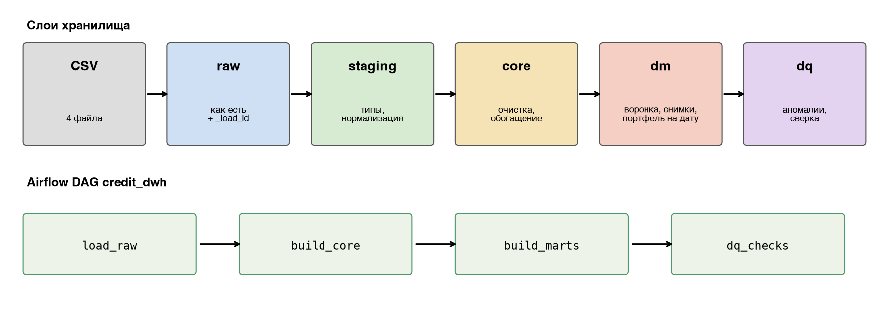

| Слой | Что в нём | Зачем |
|---|---|---|
| **raw** | 4 таблицы источника «как есть» + `_load_id` | ничего не исправляется, всегда можно вернуться к исходнику; первичные ключи дают идемпотентность |
| **etl** | `load_log` — журнал загрузок | видно, когда и сколько загружено; `_load_id` служит водяным знаком для инкремента снимков |
| **staging** | view `stg_*` | приведение типов, нормализация статуса, производные поля |
| **core** | `int_payments_clean`, `int_loans_validated` | единая точка очистки: витрины не повторяют правила фильтрации |
| **dm** | воронка, `loan_snapshot_daily`, `v_portfolio_on_date` | результаты для пользователей |
| **dq** | `dq_source_anomalies`, `dq_reconciliation` | реестр аномалий и сверка; тесты валят сборку при расхождении |

Почему так: грязные данные не правятся на входе, а очищаются один раз в core. Каждая исключённая строка
остаётся в raw и попадает в реестр dq, поэтому по любому числу в витрине можно дойти до исходной строки.

---

## 2. Загрузка в два шага и идемпотентность (2.3)

Скрипт [ingest/load.py](ingest/load.py): `--step 1`, `--step 2`, `--reset`.

* **Шаг 1** — то, что известно на 30.09.2026: заявки и кредиты, созданные до этой даты включительно,
  их графики и платежи с `loaded_at <= 30.09.2026`.
* **Шаг 2** — строгое дополнение: только строки, не вошедшие в шаг 1. Весь набор заново не перезаливается.

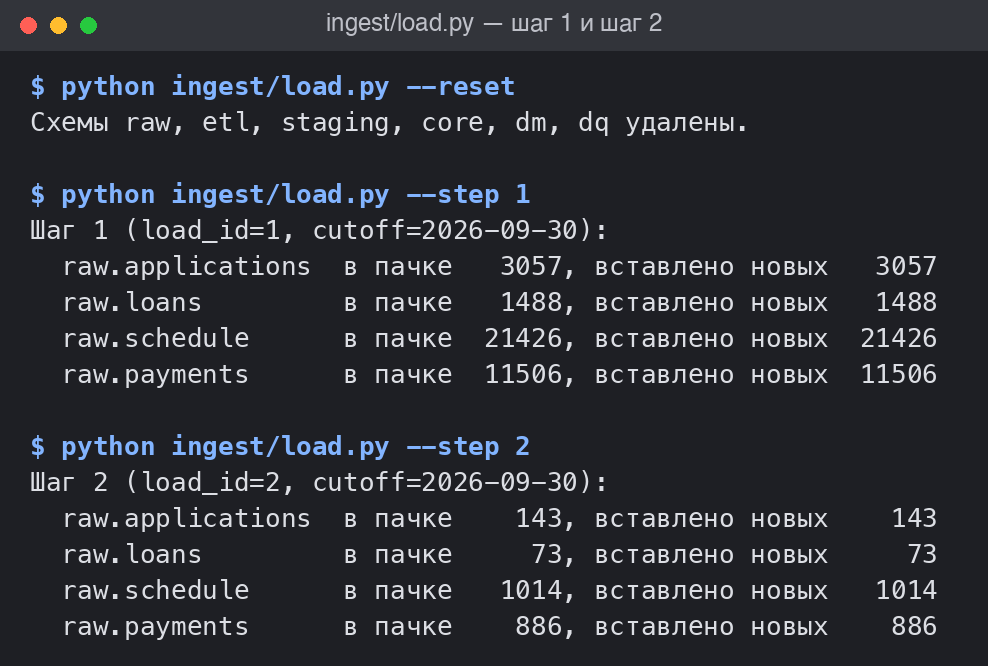

**Как обеспечена идемпотентность:**
* у raw-таблиц первичные ключи, вставка через `INSERT ... ON CONFLICT DO NOTHING`;
* шаг — одна транзакция: при ошибке не остаётся «половины» данных;
* нет `TRUNCATE`, поэтому шаг 1, запущенный после шага 2, не стирает данные шага 2.

Повторный запуск любого шага вставляет 0 строк. В журнале видно, что пачка прочитана,
но новых строк в ней нет:

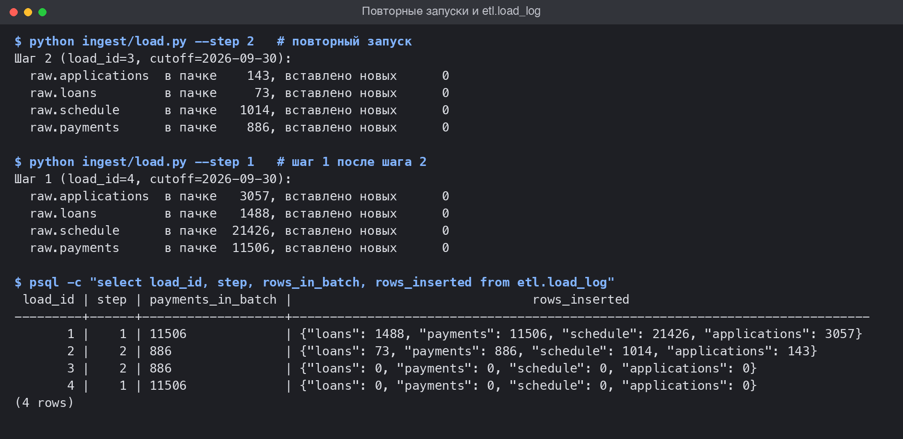

---

## 3. Сборка dbt и тесты

`dbt build` строит модели и сразу прогоняет тесты. Если тест упал, зависящие модели не строятся.

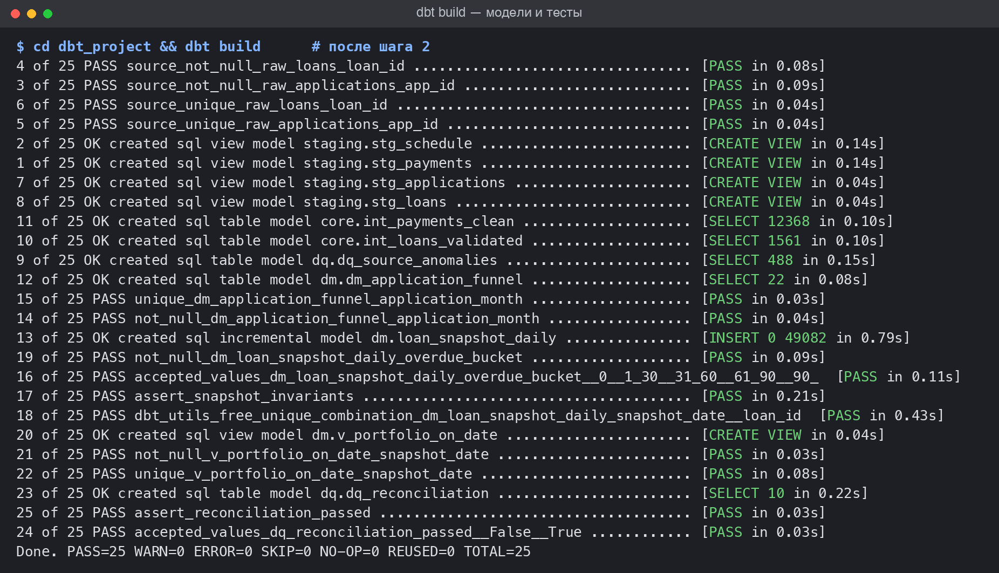

Что проверяют тесты:
* **источник:** уникальность и not null ключей;
* **витрины:** уникальность `(snapshot_date, loan_id)`, допустимые бакеты, уникальность месяцев воронки и дат портфеля;
* **инварианты снимков** ([assert_snapshot_invariants.sql](dbt_project/tests/assert_snapshot_invariants.sql)):
  нет отрицательных сумм, просрочка не больше остатка, нет строк раньше даты выдачи,
  нет дней просрочки без просроченной суммы;
* **сверка** ([assert_reconciliation_passed.sql](dbt_project/tests/assert_reconciliation_passed.sql)):
  падает, если не прошла хотя бы одна из 10 сверок (раздел 8).

---

## 4. Снимки портфеля (2.2)

`dm.loan_snapshot_daily` — строка на каждый кредит и каждый день от даты выдачи до даты актуальности данных.
Всего 522 182 строки.

**Правила на дату D** (как в ТЗ):

| Поле | Расчёт |
|---|---|
| `debt_balance` | сумма всего графика − платежи с `paid_at <= D` |
| `overdue_amount` | max(0, график с `due_date <= D` − платежи с `paid_at <= D`) |
| `days_overdue` | платежи гасят график по порядку; D − `due_date` самого раннего непогашенного платежа |
| `overdue_bucket` | 0 / 1–30 / 31–60 / 61–90 / 90+ |

**Как считается.** Состояние кредита меняется только в дни событий: выдача, плановая дата, платёж.
Поэтому сначала считается состояние на ~25 тыс. событий, а потом каждый интервал между событиями
разворачивается в дни. Это и быстрее, и проще проверить (подробнее — раздел 9).

**Инкремент.** Модель в dbt — `incremental` со стратегией `delete+insert`. Каждая строка хранит
`calc_load_id`, то есть последнюю учтённую загрузку платежей. При следующем запуске пересчитываются только:
* новые даты для всех кредитов;
* новые кредиты, начиная с даты выдачи;
* кредиты с опоздавшими платежами, начиная с `paid_at` опоздавшего платежа.

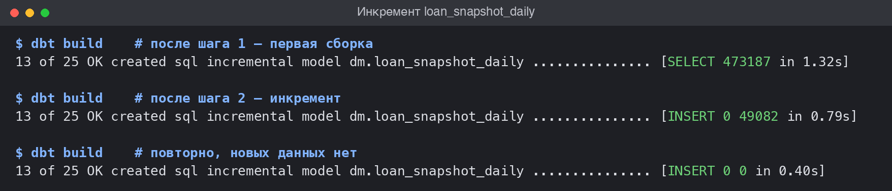

После шага 1 таблица строится целиком: 473 187 строк по 30.09. На шаге 2 дописано 49 082 строки.
Повторный запуск без новых данных — `INSERT 0 0`. Результат инкремента я сравнил с полным пересчётом через `EXCEPT`:
расхождений 0.

---

## 5. Портфель на 30.06.2026 и 31.10.2026

```sql
select * from dm.v_portfolio_on_date where snapshot_date = '2026-06-30';
```

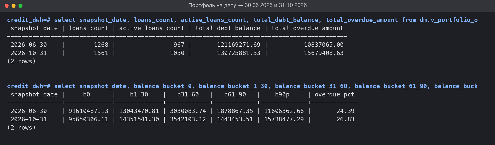

| | 30.06.2026 | 31.10.2026 |
|---|---:|---:|
| Кредитов выдано / с ненулевым остатком | 1 268 / 967 | 1 561 / 1 050 |
| **Общий остаток** | **121 169 271,69** | **130 725 881,33** |
| Просроченная сумма | 10 837 065,00 | 15 679 408,63 |
| Бакет 0 | 91 610 487,13 | 95 650 306,11 |
| Бакет 1–30 | 13 043 470,81 | 14 351 541,30 |
| Бакет 31–60 | 3 030 083,74 | 3 542 103,12 |
| Бакет 61–90 | 1 878 867,35 | 1 443 453,51 |
| Бакет 90+ | 11 606 362,66 | 15 738 477,29 |
| Доля остатка в просрочке | 24,39 % | 26,83 % |

Динамика портфеля по месяцам из того же представления:

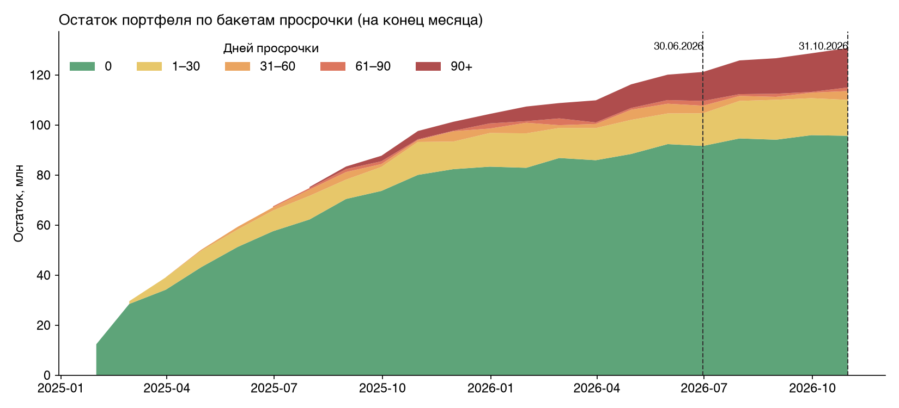

Что видно: портфель растёт, но бакет 90+ растёт быстрее. С 30.06 по 31.10 он увеличился
с 11,6 до 15,7 млн (+36 %), а весь портфель — на 8 %. Это хроническая просрочка, которая не выходит из бакета.

---

## 6. Опоздавшие платежи (2.3)

**Вопрос ТЗ:** что происходит со снимками, когда платёж с прошлой датой `paid_at` приходит с опозданием?

**Проблема.** Снимок на дату D зависит от всех платежей с `paid_at <= D`. Если платёж от 22.09 появился
в источнике только 04.10, то при расчёте 30.09 его не было. Снимки с 22.09 по 30.09 занизили погашение
и показали лишнюю просрочку.

**Решение.** Опоздавший платёж приходит с новым `_load_id`, модель его замечает и пересчитывает этот кредит
с даты `paid_at`. Другие кредиты не трогаются. Снимок означает «лучшее, что известно о состоянии на дату D».

Конкретный кредит из данных — **11333**:

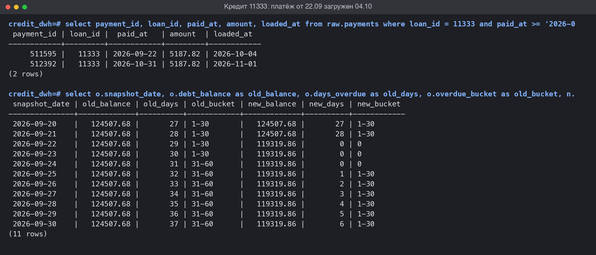

* до шага 2 (платёж ещё не известен) на 30.09: **37 дней просрочки, бакет 31–60**;
* после шага 2: платёж от 22.09 закрыл старый плановый платёж, на 30.09 **6 дней, бакет 1–30**,
  остаток меньше на 5 187,82;
* снимки до 21.09 не изменились: пересчёт идёт строго с даты опоздавшего платежа.

В целом по портфелю 25 опоздавших платежей переписали **87 исторических строк по 25 кредитам**.
На 30.09 остаток уменьшился на 339 тыс., из просрочки вышли 12 кредитов:

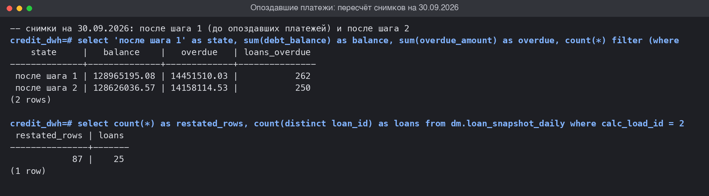

**Ограничение.** Старые значения при пересчёте не сохраняются, поэтому отчёт «как он выглядел 30.09»
из таблицы не восстановить. Какие строки были пересчитаны, видно по `calc_load_id`. Если нужно знать,
что было известно на конкретную дату (регуляторная отчётность), следующий шаг — версионировать строки:
`valid_from_load_id` / `valid_to_load_id` и закрывать старую версию вместо удаления.

---

## 7. Воронка заявок (2.1)

`dm.dm_application_funnel` — по месяцу создания заявки: заявки, одобрения, отказы, ожидающие, выдачи,
три конверсии, среднее время до решения в часах, сумма выдач.

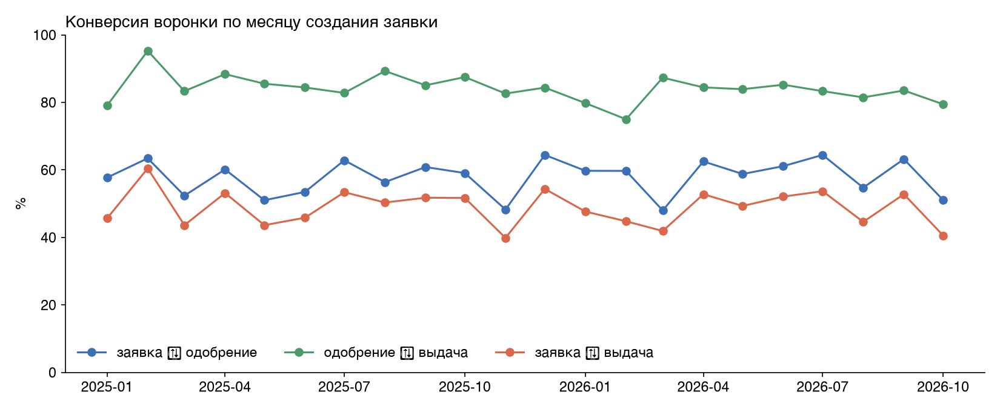

* Воронка **когортная**: выдача относится к месяцу заявки. Так конверсия честная: выдача в начале
  следующего месяца не попадает в чужой месяц.
* Конверсия «одобрение → выдача» стабильно 75–95 %, «заявка → одобрение» — 48–64 %.
* 3 кредита выданы по **отклонённым** заявкам. Они входят в общее число и сумму выдач,
  чтобы витрина сходилась с `loans`. В конверсию «одобрение → выдача» они не входят и вынесены в отдельную колонку.
* Октябрь 2026 г. неполный: 35 заявок ещё в статусе `new`, поэтому конверсии ниже.
  Это эффект незавершённой когорты, а не ухудшение.

---

## 8. Сверка и аномалии в данных (2.4)

### Сверка витрин с источником

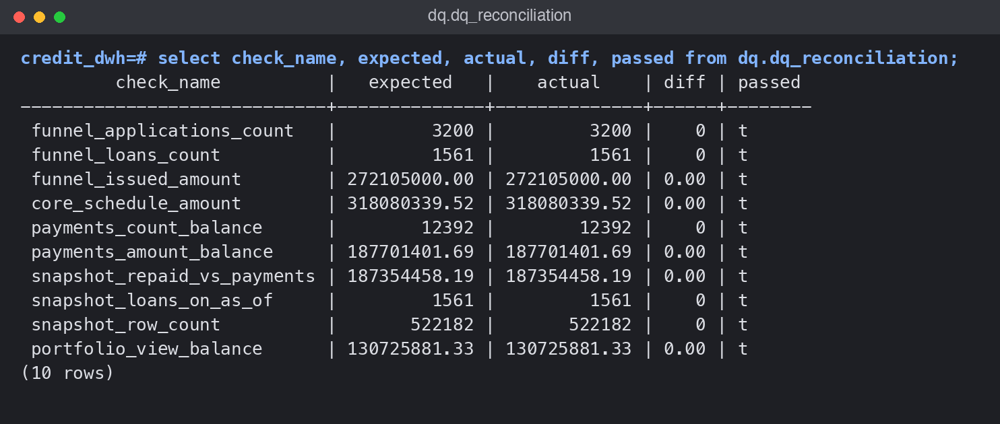

Главные сверки:
* количество и сумма выдач в воронке совпадают с `raw.loans` (1 561 кредит, 272 105 000);
* платежи в raw = очищенные + исключённые (12 392 = 12 368 + 24): ни один платёж не потерян молча;
* погашено по снимку (график − остаток) = сумма очищенных платежей (187 354 458,19);
* строк в снимке ровно Σ (дата актуальности − дата выдачи + 1).

### Найденные ошибки и аномалии

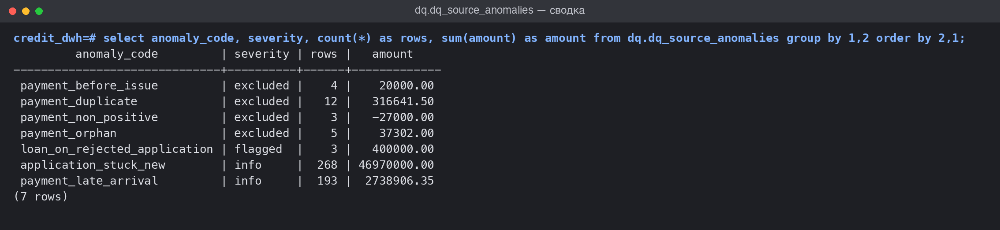

| Аномалия | Строк | Что сделано | Почему |
|---|---:|---|---|
| Платёж по несуществующему кредиту (`loan_id` 990001–990005) | 5 | исключён из core | не к чему привязать |
| Отрицательная сумма (−12 000, −7 500, −7 500) | 3 | исключён | в схеме нет понятия сторно; минус увеличил бы долг без причины |
| Платёж раньше даты выдачи (все по 5 000) | 4 | исключён | до выдачи долга нет; похоже на комиссию или ошибку даты |
| Технический дубль (кредит, дата, сумма и `loaded_at` совпадают, id рядом) | 12 | оставлен один | иначе погашение завышено на 316 тыс. |
| Кредит по отклонённой заявке | 3 | оставлен с флагом | деньги выданы, долг реальный |
| Заявка в статусе `new` дольше 30 дней | 268 | оставлена | статус не выдумываем; видно в воронке как `pending` |
| Платёж загружен на 3–15 дней позже даты оплаты | 193 | загружен, снимки пересчитаны | см. раздел 6 |

Все исключённые строки остаются в raw. Построчный список с причиной — `dq.dq_source_anomalies`
и [results/dq_anomalies_details.csv](results/dq_anomalies_details.csv).

---

## 9. Оптимизация (2.5)

Самый тяжёлый запрос — полный расчёт `loan_snapshot_daily`.

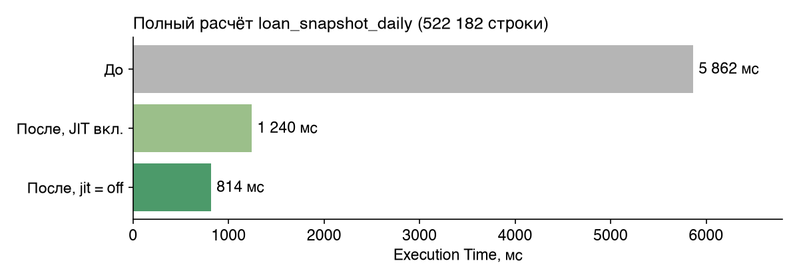

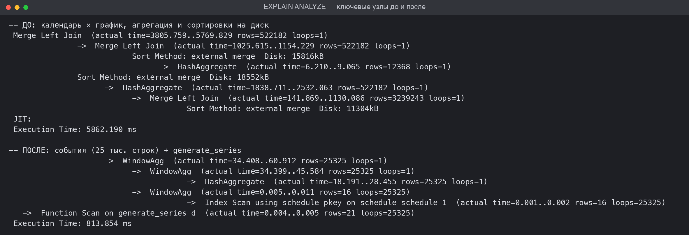

**Что было не так.** Календарь «кредит × день» (522 тыс. строк) соединялся с графиком по условию
`due_date <= snapshot_date`. Каждый день размножался на все прошедшие плановые платежи (3,2 млн строк),
затем шла агрегация обратно и три сортировки по 0,5 млн строк с выгрузкой на диск (11–18 МБ каждая).

**Что изменено.**
1. Состояние считается только в дни событий: 25 тыс. строк, оконные суммы, одна сортировка в памяти.
2. Первый непогашенный платёж ищется через `LATERAL` по первичному ключу графика.
3. Интервал между событиями разворачивается в дни через `generate_series` уже с готовыми значениями.
4. `jit = off` для этой модели: из-за завышенной оценки `generate_series` Postgres тратил 0,4 с
   на JIT-компиляцию, которая не окупалась.

**Итог: 5 862 мс → 814 мс (в 7 раз), результат построчно совпадает со старым.**
Полные планы — [docs/explain/](docs/explain/), разбор — [docs/optimization.md](docs/optimization.md).

---

## 10. Airflow (2.6)

[airflow/dags/credit_dwh_dag.py](airflow/dags/credit_dwh_dag.py): `load_raw → build_core → build_marts → dq_checks`
(схема в разделе 1).

* шаг загрузки — параметр запуска, по умолчанию 2;
* `max_active_runs=1`: инкремент снимков не должен идти параллельно сам с собой;
* тест запускается только после того, как построены все модели, на которые он ссылается
  (`--indirect-selection cautious`);
* непрошедшая сверка роняет `dq_checks`, и запуск помечается failed.

DAG проверен на синтаксис, выбор моделей в каждой задаче проверен через `dbt ls`. В живом Airflow
он не запускался.

---

## 11. Допущения и ограничения

1. **Граница шага 1 по заявкам** — дата создания. В CSV лежит финальный статус, поэтому 11 заявок,
   решённых после 30.09, на шаге 1 уже видны с итоговым статусом: истории статусов в источнике нет.
2. **График считается неизменным.** Реструктуризаций в данных нет; при изменении графика кредит нужно
   пересчитать полностью (`dbt build --full-refresh`).
3. **В плановую дату** неоплаченная сумма уже входит в просрочку (`due_date <= D` по ТЗ), но дней
   просрочки 0 и бакет «0». Таких строк 4 213.
4. Остаток — по графику (тело + проценты), пени не начисляются.
5. Снимки строятся до последней даты загрузки платежей (01.11.2026). Дальше состояние неизвестно.
6. Старые версии снимков при пересчёте не хранятся (раздел 6).
